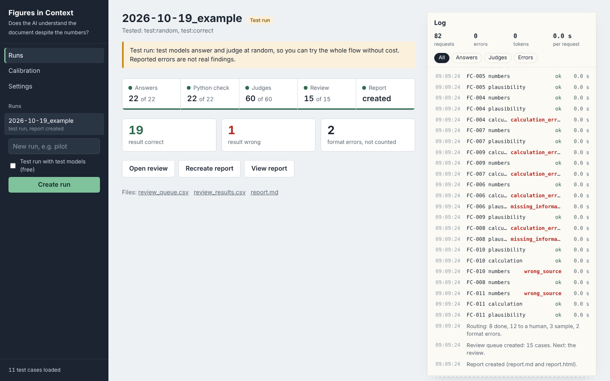
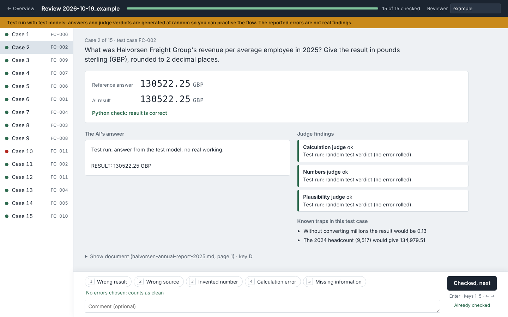

# Figures in Context

**Does an AI still understand a document when it is dense with numbers?** Annual reports, price letters and investor updates are full of figures in different units, periods and versions (restated vs. original, provisional vs. final, £ thousand vs. £ million). Figures in Context tests whether a model grasps what the document actually says and pulls out the right answer, or gets lost in the numbers.

The model answers questions about realistic business documents. Python checks every result exactly against a reference solution, three LLM judges diagnose *why* an answer went wrong, and a human confirms.



## How it works

1. **Golden dataset.** Hand-built English business documents with questions and reference solutions. Every reference solution is computed by script, not typed. Each test case lists the numbers it needs, where they appear in the document, and the known traps (restated vs. original figures, `£ thousand` vs. `£ million`, a CEO quote with a rounded number, …).
2. **Model under test.** It answers with its working and one fixed final line: `RESULT: <number> <unit>`.
3. **Exact Python check.** Decimal comparison, no tolerance. Rounding is only allowed where the question asks for it. Answers that break the format are reported separately and not counted as wrong.
4. **Three judges, three model families.** Each judge has one job and only sees what it needs:
   - *Numbers judge:* is each number taken from the right place, or is it invented?
   - *Calculation judge:* which step of the working is wrong?
   - *Plausibility judge:* is required information missing, or is something absurd?
5. **Routing.** Anything a judge flags, or that Python marks as wrong, goes to a human. A stratified 20 % sample of the "clean" answers goes too, so the judges' miss rate can be measured. The reviewer is blind to the model and to why a case was routed.
6. **Report.** Error rates per model, category, difficulty and error type, all with Wilson 95 % confidence intervals. It also reports the format error rate, the judges' miss rate and a corrected error rate, plus judge hit rates split by same vs. different model family.

**Judge calibration.** Before a run counts, the judges get 30 prepared answers with planted errors (wrong source, invented number, calculation error, missing information) and clean ones. A judge passes only if it finds every planted error in its area without flagging a clean answer.

## Run it

Python 3.9+ and nothing else: no dependencies, no `pip install`.

```
python -m figures_in_context app        # web app on http://127.0.0.1:8765
```

On Windows, double-click `start.bat`. In the web app you enter API keys (stored only in a local `.env`), pick models, start runs with live progress, review flagged cases and open the report. A live log next to each run lists every request as it comes back: test case, model or judge, result or verdict, duration, tokens and retries, with errors in red. It is saved per run in `log.jsonl`. To try it for free, create a run with "Test run" ticked: built-in test models stand in for real APIs.

Supported providers: Anthropic, OpenAI, Google Gemini (plain HTTPS calls, structured JSON output for the judges, retries with backoff).

```
python -m unittest discover tests
```

## Repository layout

| Path | Contents |
|---|---|
| `figures_in_context/` | pipeline (answers → check → judges → routing → review → report), web app, review UI |
| `test_cases/` | test cases (JSON), documents, scripts that compute the reference answers |
| `prompts/` | system prompts for the model under test and the three judges ([overview with example messages](prompts/OVERVIEW.md)) |
| `calibration/` | judge calibration answers with planted errors |
| `config/` | models, repetitions, sample size, unit aliases |
| `runs/2026-10-19_example/` | an example run with test models, including log, review results and report |
| `docs/` | [user guide](docs/USER_GUIDE.md), [concept](docs/SPEC.md) and [technical design](docs/ARCHITECTURE.md) |



## Status

The pipeline, the web app and the judge calibration are complete and tested. The test set currently has 11 cases. A full run against all three providers is still to come.
